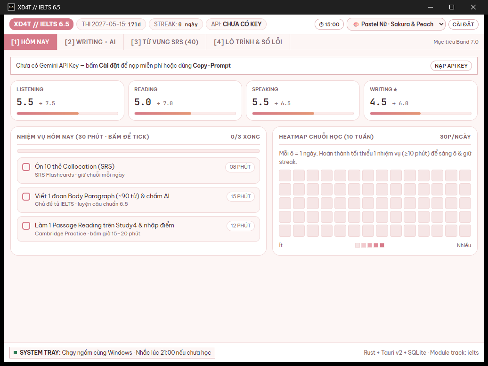
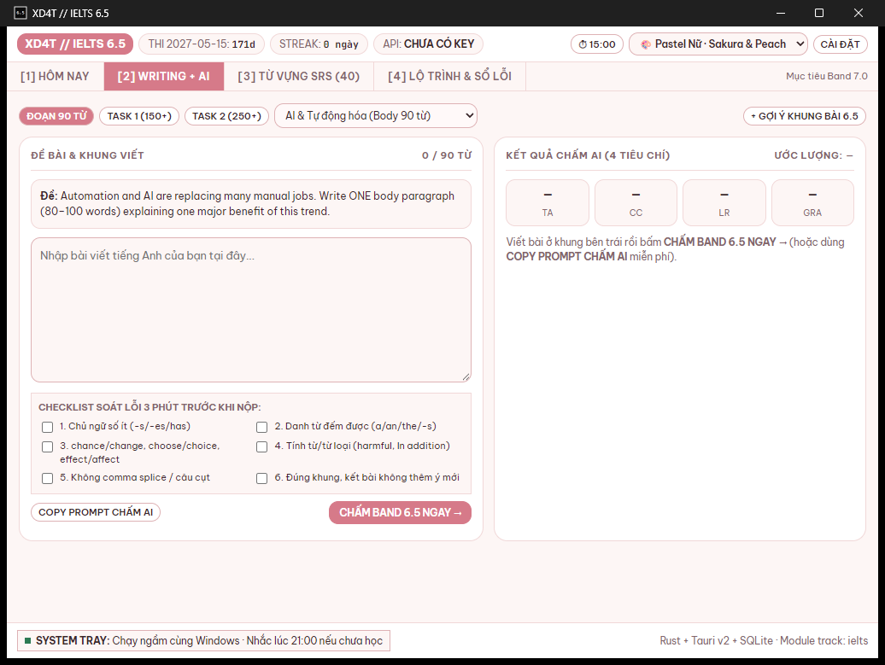
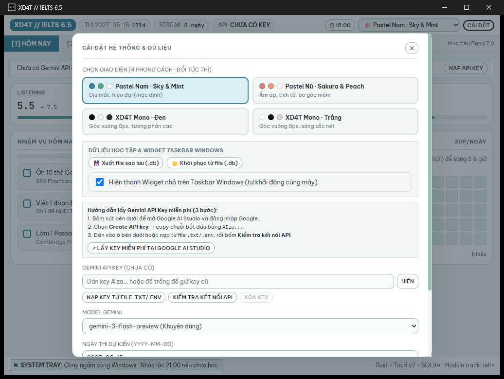

# XD4T IELTS 6.5 (`XD4T-1ELTS`)

Ứng dụng học **IELTS Band 6.5+** siêu nhẹ cho Windows 10/11 — mỗi ngày chỉ **30 phút**, lưu tiến độ hoàn toàn trên máy bạn, có **4 giao diện dịu mắt** (**Pastel Nam**, **Pastel Nữ**, **Mono Đen**, **Mono Trắng**), **chấm Writing bằng AI** và **thanh Widget nhỏ trên Taskbar Windows**.

> **[⬇️ Tải ngay bộ cài 1-file: XD4T-1ELTS-v1.2.0-Setup.exe](../../releases/latest/download/XD4T-1ELTS-v1.2.0-Setup.exe)** *(Windows 10/11 · Hoàn toàn miễn phí · Không cần cài thêm phần mềm khác)*

---

## Cài đặt chỉ trong 30 giây (3 bước)

1. **Bấm tải** file **`XD4T-1ELTS-v1.2.0-Setup.exe`** ở nút phía trên.
2. **Bấm đúp** để mở file vừa tải → bấm **Next → Install → Finish** *(không cần quyền Admin)*.
   > **Lưu ý thân thiện:** Vì đây là phần mềm mã nguồn mở miễn phí (chưa mua chứng chỉ ký số thương mại), nếu Windows hiện màn hình xanh **"Windows protected your PC"**, bạn chỉ cần bấm **More info** (Thông tin thêm) → **Run anyway** (Vẫn chạy) là cài bình thường.
3. **Mở ứng dụng** từ Desktop hoặc Start Menu → chọn màu **Pastel Nam / Pastel Nữ / Mono** trong màn hình Chào mừng → **bắt đầu học ngay!**

---

## Giao diện 3 phong cách (Pastel Nam · Pastel Nữ · XD4T Mono)

### Màn hình Chào mừng & Dashboard Pastel Nam (Mặc định · Sky & Mint)
| Thiết lập nhanh 3 bước cho người mới | Dashboard Hôm Nay (Pastel Nam) |
|---|---|
|  |  |

### Pastel Nữ (Sakura & Peach) — Dịu dàng, ấm áp
| Dashboard Hôm Nay (Pastel Nữ) | Phòng luyện Writing + Chấm AI (Pastel Nữ) |
|---|---|
|  |  |

### Cài đặt, Sao lưu 1-Click & Thanh Widget Taskbar đồng bộ màu
| Cài đặt & Sao lưu / Khôi phục ngay trong App | Widget Taskbar Windows đồng bộ màu Pastel |
|---|---|
|  |  |

*(Bạn vẫn có thể chuyển sang **XD4T Mono Đen / Trắng** góc vuông bất cứ lúc nào ngay trên thanh trên cùng của ứng dụng.)*

---

## Tính năng chính dành cho người tự học

- **Học gọn 30 phút mỗi ngày:** 3 nhiệm vụ rõ ràng, đếm ngược Pomodoro 15 phút, Heatmap chuỗi ngày học để không bị đứt nhịp.
- **Chấm Writing 4 tiêu chí (`TA / CC / LR / GRA`):** Hỗ trợ gợi ý khung bài Band 6.5, checklist soát lỗi 3 phút, sửa lỗi trực tiếp và bài mẫu nâng Band.
- **Từ vựng SRS thông minh (Offline):** 40+ collocation Band 6.5 tự động lặp lại ngắt quãng (`Quên / Khó / Nhớ / Dễ`).
- **Lộ trình 24 tuần & Sổ lỗi:** Theo dõi tiến độ từng tuần, lưu điểm đề thi thử và gom các lỗi hay mắc.
- **Widget Taskbar Windows 11:** Thanh nhỏ gọn hiển thị số nhiệm vụ xong hôm nay, chuỗi ngày học và Band hiện tại ngay cạnh nút Thời tiết (có thể bật/tắt bằng 1 cú click trong **Cài đặt**).

---

## Cá nhân hóa lộ trình với ChatGPT / Gemini

App đã có sẵn **Lộ trình mẫu 24 tuần (Band 6.5)** dùng được ngay. Nếu muốn lộ trình riêng theo điểm đầu vào và ngày thi của bạn:

1. Mở tab **`[4] LỘ TRÌNH & SỔ LỖI`** → bấm **`+ NẠP LỘ TRÌNH .MD`** (hoặc bấm ngay ở **Bước 2** trong màn hình Chào mừng).
2. Bấm **`COPY PROMPT TẠO LỘ TRÌNH CHO AI`** và dán vào **ChatGPT / Gemini / Claude**. AI sẽ hỏi 5 câu ngắn rồi tạo sẵn file `lo-trinh.md` cho bạn.
3. Bấm **`CHỌN FILE .MD TỪ MÁY`** (hoặc dán nội dung vào khung) → **`PHÂN TÍCH & XEM TRƯỚC`** → **`ÁP DỤNG LỘ TRÌNH NGAY`**.

---

## Lấy Gemini API Key miễn phí (để AI tự chấm bài)

1. Mở **`CÀI ĐẶT`** → bấm **`↗ LẤY KEY MIỄN PHÍ TẠI GOOGLE AI STUDIO`**.
2. Đăng nhập Google → bấm **Create API key** → copy chuỗi key (`AIza...`).
3. Dán vào ô **Gemini API Key** trong app → bấm **`KIỂM TRA KẾT NỐI API`** → **`LƯU CÀI ĐẶT`**.
   *(Không muốn tạo key? Bạn vẫn dùng nút **`COPY PROMPT CHẤM AI`** ở tab Writing để dán sang ChatGPT/Gemini web hoàn toàn miễn phí!)*

---

## Sao lưu dữ liệu trước khi đổi máy / cài lại Windows

Bạn **không cần gõ bất kỳ câu lệnh nào**:
- Mở **`CÀI ĐẶT`** → mục **Dữ liệu học tập & Widget Taskbar**:
  - Bấm **`💾 Xuất file sao lưu (.db)`** để lưu toàn bộ tiến độ, từ vựng SRS, điểm thi và sổ lỗi thành 1 file `.db` cất vào USB / Google Drive.
  - Khi sang máy mới hoặc cài lại Windows, cài xong app chỉ cần bấm **`📂 Khôi phục từ file (.db)`** và chọn lại file đó là nguyên vẹn 100%!

---

## Hỏi đáp nhanh (FAQ)

- **App có cần mạng Internet để học không?**
  Không! Từ vựng SRS, lộ trình, nhiệm vụ hàng ngày, Pomodoro và sổ lỗi đều chạy 100% offline trên máy bạn. Chỉ cần mạng khi bấm **Chấm Writing bằng Gemini AI**.
- **Gỡ cài đặt có làm mất tiến độ đang học không?**
  Không. Bộ gỡ cài đặt chuẩn trong *Windows Settings → Apps* sẽ giữ lại dữ liệu học của bạn ở `%APPDATA%\xd4t-ielts65\ielts65.db` để khi cài lại không bị mất bài.
- **Widget Taskbar có đè lên nút Thời tiết hay làm chậm máy không?**
  Widget tự động dò vị trí nút Thời tiết của Windows 11 để né sang bên cạnh, tiêu tốn chưa tới 10 MB RAM. Nếu không thích, bạn có thể tắt ngay bằng công tắc trong **Cài đặt**.

---

<details>
<summary><b>Dành cho lập trình viên: Tự build từ mã nguồn, kiến trúc & script PowerShell</b></summary>

### Kiến trúc kỹ thuật
- **Desktop App:** Rust + Tauri v2 + TypeScript + Vite + SQLite (`rusqlite` bundled, WAL mode).
- **Taskbar Widget:** `XD4TIeltsBar.exe` (.NET Framework 4.x WinForms + UIAutomation, đồng bộ thời gian thực qua `%APPDATA%\xd4t-ielts65\widget-status.json`).
- **Bộ cài:** Tauri NSIS (`currentUser` mode, không yêu cầu UAC Admin, kèm `src-tauri/nsis/hooks.nsh`).

### Build từ mã nguồn (Windows)
```powershell
# 1. Cài dependencies frontend
npm install

# 2. Build Taskbar Widget
powershell -ExecutionPolicy Bypass -File .\taskbar-widget\build.ps1

# 3. Chạy unit test Rust
cd src-tauri
cargo test
cd ..

# 4. Build bộ cài 1-file NSIS (kèm remap path chống lộ đường dẫn cá nhân)
$env:RUSTFLAGS = "--remap-path-prefix=$env:USERPROFILE\.cargo=/cargo --remap-path-prefix=$env:USERPROFILE=/user --remap-path-prefix=$PWD=/src"
npx tauri build
```

### Script PowerShell hỗ trợ (tùy chọn)
Repo vẫn giữ các script tiện ích cho người dùng nâng cao: `install.ps1`, `uninstall.ps1`, `backup-db.ps1`, `restore-db.ps1`.

</details>
