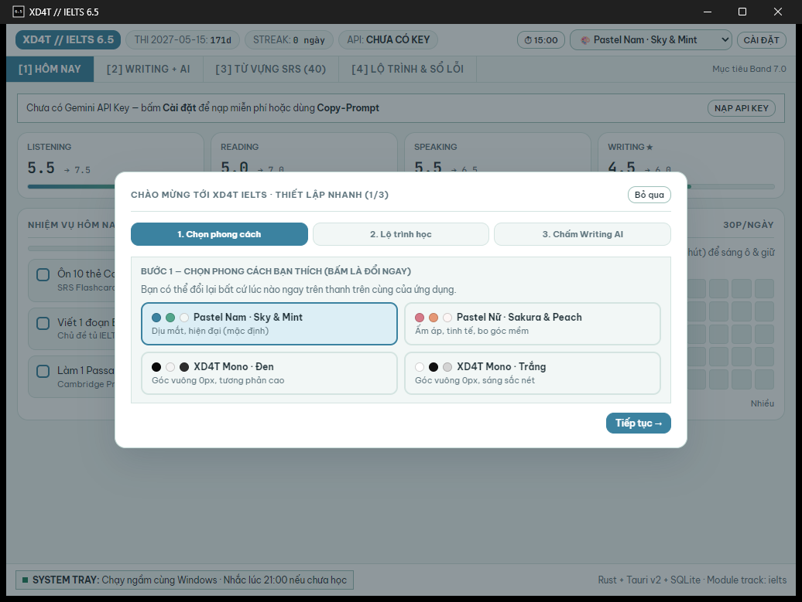
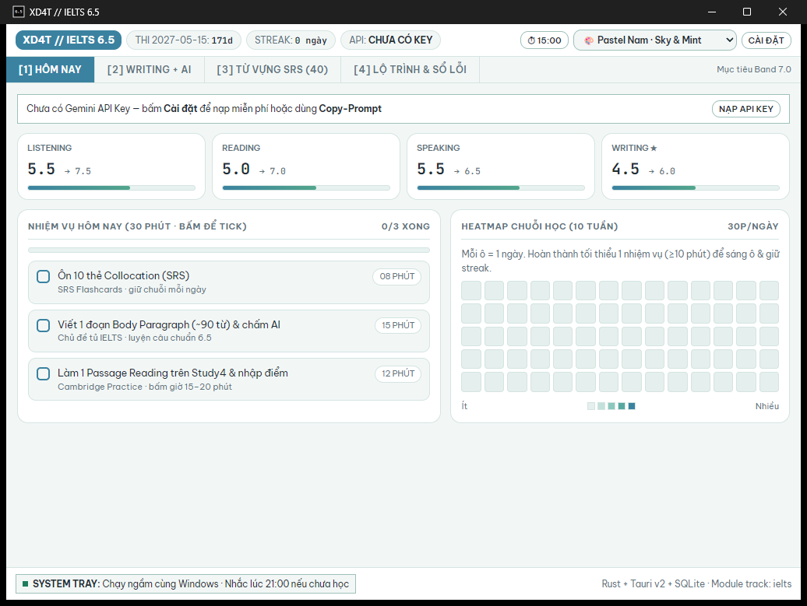

# XD4T IELTS 6.5 (`XD4T-1ELTS`)

Ứng dụng tự học **IELTS Band 6.5+** gọn nhẹ cho Windows 10/11 — mỗi ngày chỉ cần **30 phút**, lưu toàn bộ bài học ngay trên máy bạn. Có **4 màu giao diện dịu mắt** (**Pastel Nam**, **Pastel Nữ**, **Mono Đen**, **Mono Trắng**), **AI chấm bài viết** và **thanh nhắc nhỏ dưới góc màn hình**.

> **[⬇️ Tải ngay bộ cài 1-file: XD4T-1ELTS-v1.6.0-Setup.exe](https://github.com/xd4t/XD4T-1ELTS/releases/latest/download/XD4T-1ELTS-v1.6.0-Setup.exe)** *(Windows 10/11 · Miễn phí · Bấm là cài, không cần cài thêm gì)*
>
> **[📖 Hướng dẫn sử dụng chi tiết từ A–Z (cách luyện Study4, Speaking Studio, Nghe chép câu, chấm Writing AI...)](docs/HUONG-DAN-SU-DUNG.md)**

---

## Cài đặt trong 30 giây (3 bước)

1. **Tải file** **`XD4T-1ELTS-v1.6.0-Setup.exe`** ở nút phía trên.
2. **Mở file vừa tải** → bấm **Next → Install → Finish** *(nếu Windows hiện bảng xanh "Windows protected your PC", chỉ cần bấm **More info** → **Run anyway**)*.
3. **Mở app** từ màn hình chính, chọn màu giao diện bạn thích rồi **bắt đầu học ngay**.

---

## Xem trước giao diện

| Màn hình Chào mừng (chọn màu & lộ trình) | Trang học hôm nay — Pastel Nam (xanh dịu) |
|---|---|
|  |  |

| Trang học hôm nay — Pastel Nữ (hồng đào) | Phòng luyện viết & AI chấm bài — Pastel Nữ |
|---|---|
|  |  |

| Cài đặt & nút Lưu / Khôi phục bài học | Thanh nhắc nhỏ dưới góc màn hình |
|---|---|
|  |  |

---

## App giúp bạn học gì mỗi ngày? (`v1.6.0` · Hệ Sinh Thái 4 Kỹ Năng Khép Kín)

- **Nhiệm vụ `CORE ≤ 30 phút` vs `BONUS` (đan xen 4 buổi Study4 thi thật):** Mỗi ngày gồm **SRS 8p + Micro-Check 2p + 1 kỹ năng trọng tâm 16–20p** (có nút mở 1 chạm tới đúng công cụ hoặc Study4). Chỉ nhiệm vụ Core tính vào streak!
- **Phòng Luyện Nói (Speaking Studio — 48 Cue Card 24 tuần):** Chọn chế độ **Thi thật (Part 2 2:00 + Part 3)** hoặc **Phản xạ 4-3-2**, ghi âm nén trực tiếp và bấm **Chấm AI (Gemini Audio)** (hoặc dùng nút Copy Prompt + Checklist tự chấm 5 mục miễn phí).
- **Nghe chép câu (Listening Dictation — 100% Offline):** 24 câu bẫy thực chiến (số nhiều `-s`, đuôi `-ed`, con số, từ đổi ý), chỉnh tốc độ `0.85x / 1.0x / 1.15x`, chấm **Word-by-word Diff** xanh/đỏ và đẩy ngay từ sai vào Sổ lỗi.
- **Luyện viết có Top 3 Lỗi & Cảnh báo lặp lỗi:** Thanh nhắc **Top 3 lỗi hay mắc** ngay trên khung viết; sau khi chấm AI, tự cảnh báo nếu lặp lại lỗi trong Top 3 kèm nút luyện sửa lỗi ngay.
- **Flashcard SM-2, Chữa 🔥 Từ cứng đầu & Quiz Sửa Lỗi:** Hỗ trợ **Audio-First (`en-GB`/`en-US`)**, **Câu đục lỗ**, tự thêm từ (**Sentence Mining**), nút **`✍️ Chữa từ này`** cho thẻ quên ≥ 3 lần, **Quiz Gõ Sửa Lỗi** và **Micro-Check 5 câu (2p)**.
- **Bảng Paraphrase Reading & Lộ trình 24 tuần Dual-Track (`6.5` & `8.0`):** Lưu cặp đồng nghĩa Reading 4 cột (tự nuôi vào Micro-Check), kèm mẫu nạp lộ trình chuẩn **`docs/LO-TRINH-MAU-V1.6.md`**.
- **Thanh nhắc nhỏ dưới góc màn hình:** Hiện số bài Core đã xong hôm nay, chuỗi ngày học và mức điểm hiện tại ngay cạnh đồng hồ Windows.

---

## 3 việc hay dùng nhất

> Xem hướng dẫn đầy đủ từng bước cho người mới tại: **[📖 Hướng dẫn sử dụng chi tiết từ A–Z](docs/HUONG-DAN-SU-DUNG.md)**

### 1. Đổi sang lộ trình học riêng bằng ChatGPT / Gemini
1. Mở mục **Lộ trình & Sổ lỗi** → bấm **Nạp lộ trình**.
2. Bấm **Copy mẫu hỏi AI**, dán vào **ChatGPT** hoặc **Gemini** để AI tạo lộ trình riêng theo ngày thi của bạn.
3. Chọn file lộ trình vừa tạo (hoặc dán thẳng vào khung) → bấm **Áp dụng lộ trình ngay**.

### 2. Bật AI tự chấm bài viết miễn phí
1. Mở **Cài đặt** → bấm **Lấy key miễn phí tại Google AI Studio**.
2. Đăng nhập Google → bấm **Create API key** → copy dòng mã vừa tạo.
3. Dán vào ô **Gemini API Key** trong app → bấm **Kiểm tra** → **Lưu**.
   *(Không muốn tạo key? Bạn vẫn có thể bấm nút **Copy sang ChatGPT / Gemini web** ở phòng luyện viết để chấm miễn phí!)*

### 3. Lưu bài học trước khi đổi máy / cài lại Windows
1. Mở **Cài đặt** → bấm **Xuất file sao lưu** để lưu toàn bộ bài học thành 1 file cất vào USB hoặc Google Drive.
2. Sang máy mới, cài app xong chỉ cần vào **Cài đặt** → bấm **Khôi phục** và chọn lại file đó.
3. Toàn bộ tiến độ, từ vựng, điểm thi và sổ lỗi sẽ còn nguyên như cũ.

---

## Hỏi đáp nhanh

- **Có cần mạng Internet để học không?**
  Không. Mọi bài học, từ vựng, đồng hồ tập trung và sổ lỗi đều chạy không cần mạng; chỉ cần mạng khi bạn bấm nút nhờ AI chấm bài viết.
- **Gỡ app ra có mất bài đang học không?**
  Không. Khi bạn gỡ app theo cách thông thường của Windows, dữ liệu học vẫn được giữ lại an toàn trên máy để lần sau cài lại vẫn còn nguyên.
- **Tắt thanh nhắc dưới góc màn hình ở đâu?**
  Vào **Cài đặt** trong app và gạt tắt mục **Thanh nhắc Taskbar** là xong ngay.

---

## ☕ Ủng hộ tác giả

App hoàn toàn miễn phí và không quảng cáo. Nếu **XD4T IELTS 6.5** giúp bạn học đều tay hơn mỗi ngày, bạn có thể mời tác giả một ly cà phê qua mã VietQR bên dưới để tiếp thêm động lực duy trì và cập nhật thêm tính năng mới. Cảm ơn bạn rất nhiều!

<p align="center">
  
</p>

<p align="center"><code>MB Bank · 9888888881808 · PHAM XUAN DAT</code></p>

---

<details>
<summary><b>Dành cho lập trình viên: Tự build từ mã nguồn, kiến trúc & script hỗ trợ</b></summary>

### Kiến trúc kỹ thuật
- **Desktop App:** Rust + Tauri v2 + TypeScript + Vite + SQLite (`rusqlite` bundled, WAL mode).
- **Taskbar Widget:** `XD4TIeltsBar.exe` (.NET Framework 4.x WinForms + UIAutomation, đồng bộ thời gian thực qua `%APPDATA%\xd4t-ielts65\widget-status.json`).
- **Bộ cài:** Tauri NSIS (`currentUser` mode, không yêu cầu UAC Admin, kèm `src-tauri/nsis/hooks.nsh`).

### Build từ mã nguồn (Windows)
```powershell
# 1. Cài dependencies frontend
npm install

# 2. Build Taskbar Widget
powershell -ExecutionPolicy Bypass -File .\taskbar-widget\build.ps1

# 3. Chạy unit test Rust
cd src-tauri
cargo test
cd ..

# 4. Build bộ cài 1-file NSIS (kèm remap path chống lộ đường dẫn cá nhân)
$env:RUSTFLAGS = "--remap-path-prefix=$env:USERPROFILE\.cargo=/cargo --remap-path-prefix=$env:USERPROFILE=/user --remap-path-prefix=$PWD=/src"
npx tauri build
```

### Script PowerShell hỗ trợ (tùy chọn)
Repo vẫn giữ các script tiện ích cho người dùng nâng cao: `install.ps1`, `uninstall.ps1`, `backup-db.ps1`, `restore-db.ps1`.

</details>
