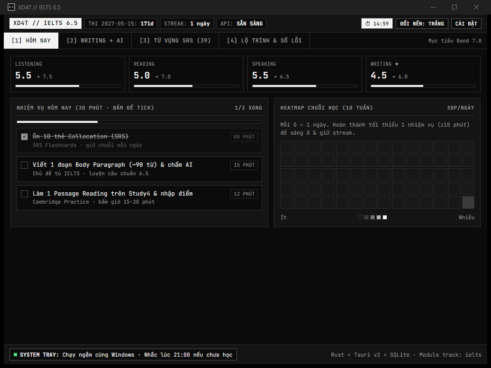
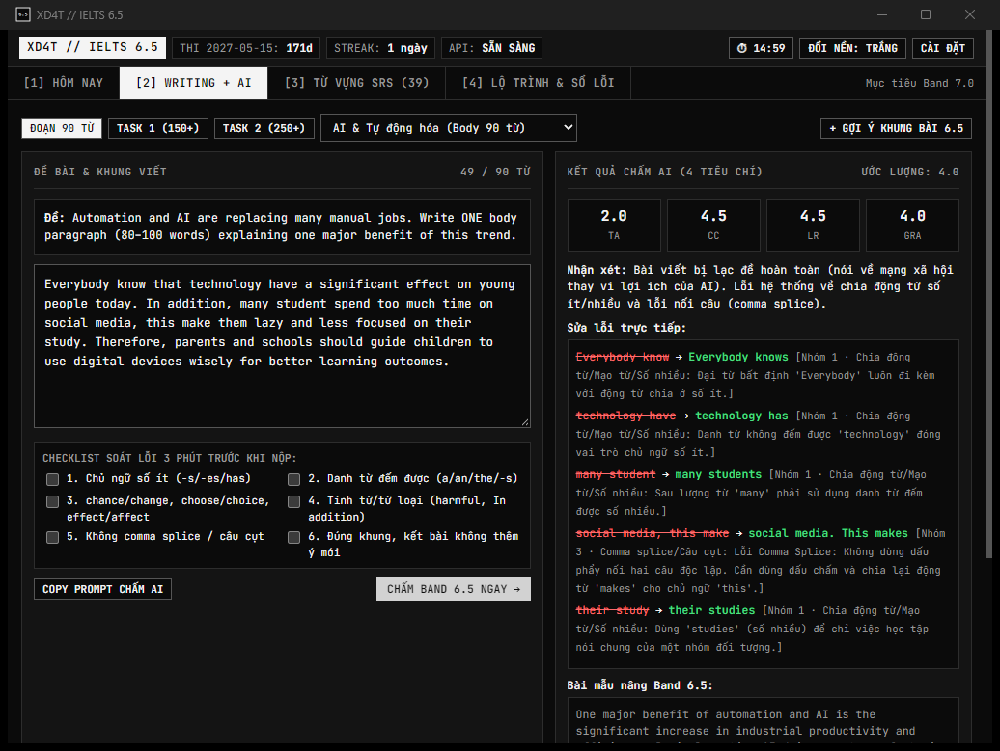
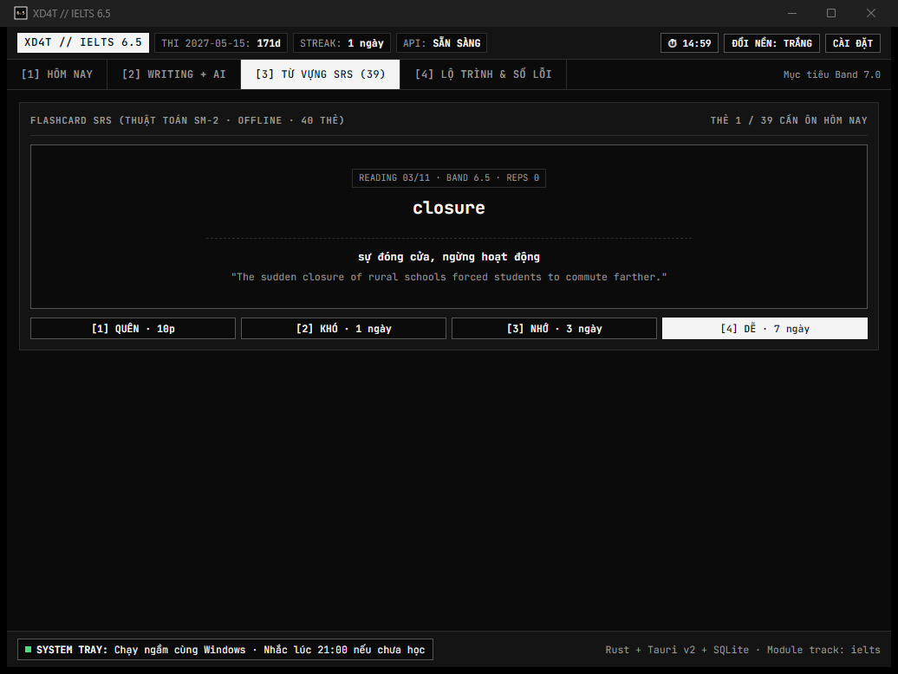
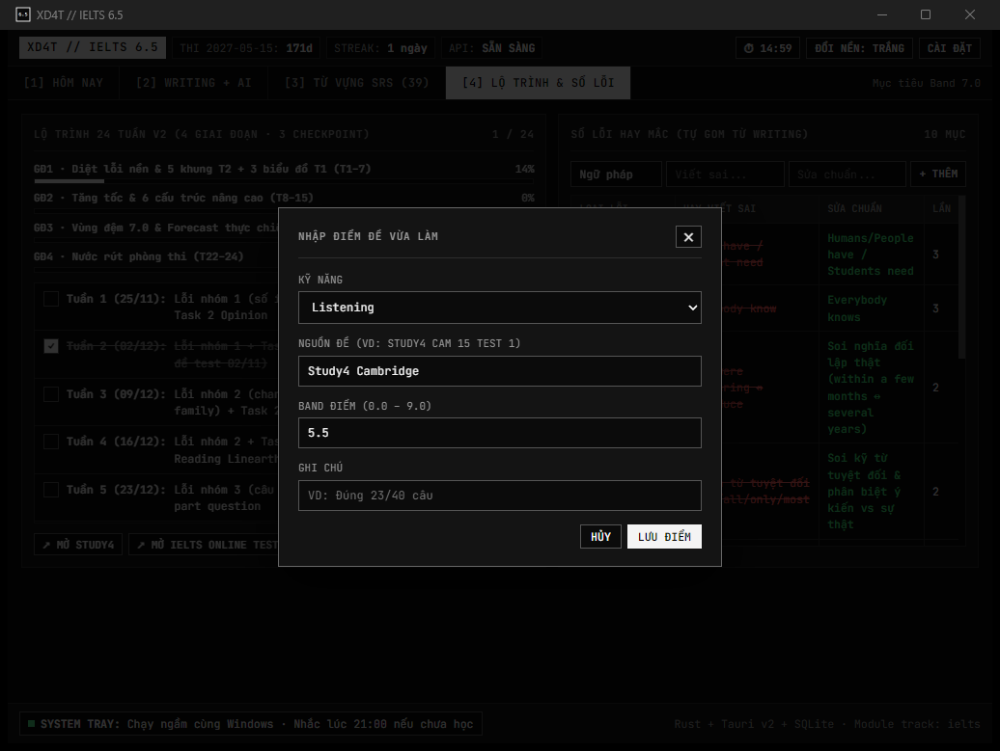
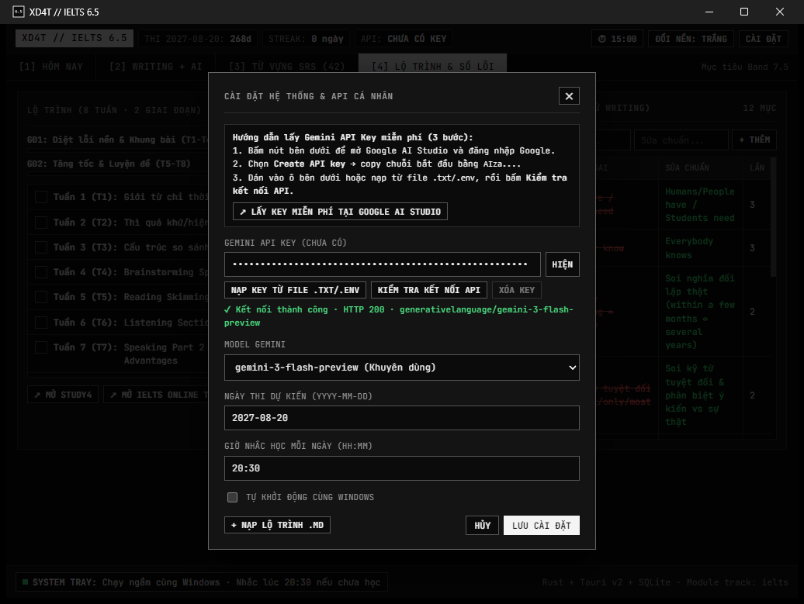
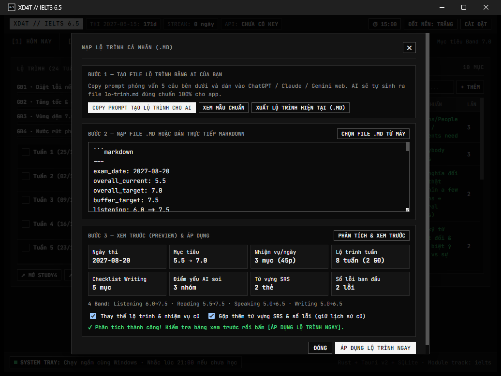
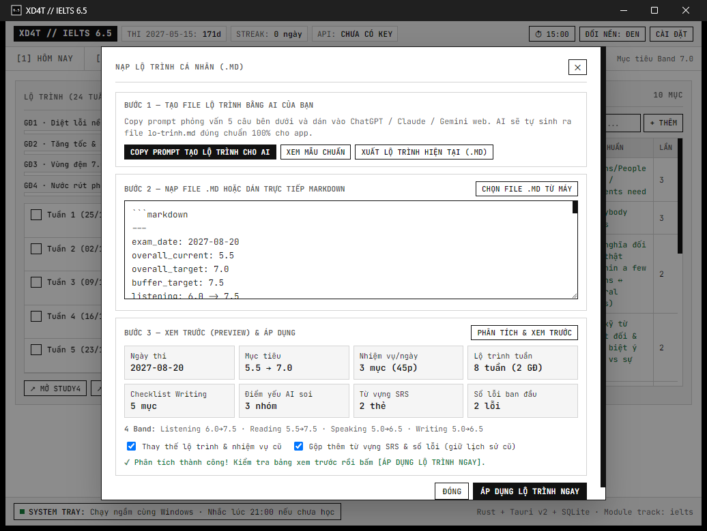

# XD4T // IELTS 6.5 (`XD4T-1ELTS`)

Ứng dụng desktop siêu nhẹ dành cho Windows 11 giúp luyện **IELTS Band 6.5+** mỗi ngày trong 30 phút — thiết kế tối giản **Monochrome Đen/Trắng**, lưu trữ 100% cục bộ bằng **SQLite**, tích hợp **AI chấm Writing 4 tiêu chí** và **Widget Taskbar Windows 11** tự né nút Thời tiết.


---

## Giao diện thực tế

### Dashboard Hôm Nay & Widget Taskbar Win11



### Writing Lab + Chấm Band 6.5 bằng Gemini AI


### Từ vựng SRS (SM-2 Offline) & Lộ trình 24 tuần + Sổ lỗi
| Flashcard SRS (SM-2) | Lộ trình 24 tuần & Sổ lỗi |
|---|---|
|  |  |

### Modal Nhập điểm, Nạp lộ trình `.md` & Cài đặt (Dark / Light Mode)
| Nhập điểm đề vừa làm (Dark) | Cài đặt & Test API (Dark) |
|---|---|
|  |  |

| Nạp lộ trình `.md` (Dark) | Nạp lộ trình `.md` (Light) |
|---|---|
|  |  |

---

## Tính năng nổi bật

- **Siêu nhẹ, khởi động tức thì:** App chính ~14 MB RAM (Rust + Tauri v2 + WebView2), Widget Taskbar ~8 MB RAM (WinForms .NET 4.x thuần).
- **Phong cách XD4T Monochrome Đen / Trắng:** Chuyển đổi tức thì giữa Dark & Light mode, hỗ trợ phím `Escape` / bấm nền ngoài để đóng modal.
- **Tab `[1] HÔM NAY`:** 3 nhiệm vụ 30 phút/ngày, Heatmap chuỗi học 10 tuần, đếm ngược ngày thi, Pomodoro 15:00 tích hợp.
- **Tab `[2] WRITING + AI`:** Luyện đoạn 90 từ, Task 1 (150+), Task 2 (250+) kèm gợi ý khung bài 6.5, checklist soát lỗi 3 phút, chấm điểm 4 tiêu chí (`TA / CC / LR / GRA`) qua Gemini API hoặc nút **Copy Prompt** dùng miễn phí trên web, và lưu lỗi thẳng vào Sổ lỗi.
- **Tab `[3] TỪ VỰNG SRS`:** 40+ thẻ collocation/từ vựng Band 6.5 chạy thuật toán **SM-2 offline** (`Quên / Khó / Nhớ / Dễ`).
- **Tab `[4] LỘ TRÌNH & SỔ LỖI`:** Lộ trình 24 tuần 4 giai đoạn (Cambridge / Simon / Linearthinking), theo dõi điểm đề thi thử, và Sổ lỗi tự gom từ Writing.
- **System Tray & Taskbar Widget Win11:** Tự nhắc học mỗi ngày theo giờ cấu hình; thanh widget ghim gọn bên trái Taskbar, tự động dò UIA để né nút Thời tiết/Widgets.

---

## Cá nhân hóa lộ trình bằng file `.md` + AI

Bất kỳ ai tải app đều có thể tạo lộ trình riêng theo band đầu vào, mục tiêu và ngày thi của mình trong 1 phút:

1. Mở tab **`[4] LỘ TRÌNH & SỔ LỖI`** → bấm **`+ NẠP LỘ TRÌNH .MD`**.
2. Bấm **`COPY PROMPT TẠO LỘ TRÌNH CHO AI`** (hoặc xem trực tiếp tại [docs/PROMPT-TAO-LO-TRINH.md](docs/PROMPT-TAO-LO-TRINH.md)), dán vào ChatGPT / Claude / Gemini web. AI sẽ hỏi 5 câu ngắn rồi xuất ra file `lo-trinh.md` chuẩn [docs/lo-trinh-mau.md](docs/lo-trinh-mau.md).
3. Dán nội dung hoặc chọn file `.md` → bấm **`PHÂN TÍCH & XEM TRƯỚC`** → bấm **`ÁP DỤNG LỘ TRÌNH NGAY`**. Toàn bộ 4 tab, nhiệm vụ hàng ngày, Checklist Writing và tiêu chí AI soi lỗi sẽ tự động cập nhật theo lộ trình của bạn.

---

## Tự nạp & kiểm tra Gemini API Key cá nhân

1. Mở **`CÀI ĐẶT`** (hoặc bấm nút **`NẠP API KEY`** trên thanh nhắc ở Tab Hôm nay).
2. Bấm **`↗ LẤY KEY MIỄN PHÍ TẠI GOOGLE AI STUDIO`** để tạo key miễn phí (`AIza...`).
3. Dán trực tiếp vào ô nhập (có nút **`HIỆN/ẨN`**) hoặc bấm **`NẠP KEY TỪ FILE .TXT/.ENV`**.
4. Bấm **`KIỂM TRA KẾT NỐI API`** để app test sống qua HTTP header `x-goog-api-key` (không truyền key trên URL) trước khi lưu. Nếu chưa muốn dùng key, bạn vẫn có thể dùng nút **`COPY PROMPT CHẤM AI`** hoàn toàn miễn phí.

---

## Cài đặt siêu nhanh (1-Click cho máy mới / sau khi reset Windows)

Không cần cài Rust hay Node.js:

1. Tải **`XD4T-1ELTS-v1.1.0-win-x64.zip`** từ trang [**GitHub Releases**](../../releases) và giải nén.
2. Mở PowerShell tại thư mục vừa giải nén và chạy:
   ```powershell
   powershell -ExecutionPolicy Bypass -File .\install.ps1
   ```
   *(Tùy chọn: thêm `-NoWidget` nếu không muốn cài Widget Taskbar, hoặc `-NoAutostart` nếu không muốn tự khởi động widget cùng Windows.)*
3. Mở **XD4T IELTS 6.5** từ Desktop hoặc Start Menu → bấm **CÀI ĐẶT** → dán **Gemini API Key** (tạo miễn phí tại Google AI Studio) và chọn ngày thi là dùng ngay.

Để gỡ cài đặt (giữ nguyên dữ liệu học):
```powershell
powershell -ExecutionPolicy Bypass -File .\uninstall.ps1
```
*(Thêm `-PurgeData` nếu muốn xóa luôn cơ sở dữ liệu học tập.)*

---

## Sao lưu & Khôi phục dữ liệu học khi reset máy

Trước khi cài lại Windows, sao lưu toàn bộ tiến độ, streak, từ vựng SRS, điểm thi và sổ lỗi thành 1 file `.db` duy nhất:

```powershell
powershell -ExecutionPolicy Bypass -File .\backup-db.ps1
```

Sau khi reset máy và chạy `install.ps1`, khôi phục lại dữ liệu cũ bằng 1 lệnh:

```powershell
powershell -ExecutionPolicy Bypass -File .\restore-db.ps1 -BackupFile .\ielts65-backup-YYYYMMDD-HHMM.db
```

---

## Tự build từ mã nguồn (Developer)

Yêu cầu trên Windows 11:
- **Node.js** (v18+)
- **Rust** (`rustup` + `cargo`)
- **Visual Studio Build Tools** (Desktop development with C++)
- **Microsoft Edge WebView2 Runtime** (có sẵn trên Windows 11)

```powershell
npm install
npm run build
cargo test --manifest-path src-tauri\Cargo.toml
npx tauri build
powershell -ExecutionPolicy Bypass -File .\taskbar-widget\build.ps1
```

---

## Bảo mật & Quyền riêng tư

- **100% Local-First:** Toàn bộ dữ liệu học tập, bài viết, thẻ từ vựng và cài đặt lưu cục bộ tại `%APPDATA%\xd4t-ielts65\ielts65.db`.
- **Không Telemetry:** Ứng dụng không gửi dữ liệu phân tích hay sử dụng về máy chủ bên thứ ba.
- **API Key an toàn:** Gemini API Key chỉ lưu trên máy người dùng và chỉ gửi trực tiếp tới Google Gemini API khi bạn bấm nút chấm bài.

---

## Kiến trúc mở rộng (`track`)

Cơ sở dữ liệu SQLite sử dụng cột `track` (mặc định `'ielts'`) ở các bảng `daily_quests`, `study_days`, `vocab_cards`, và `roadmap_items`. Nhờ thiết kế này, ứng dụng có thể dễ dàng gắn thêm các lộ trình học song song khác (ví dụ: `plc`, `aiot`, `japanese`) mà không cần thay đổi cấu trúc bảng.
