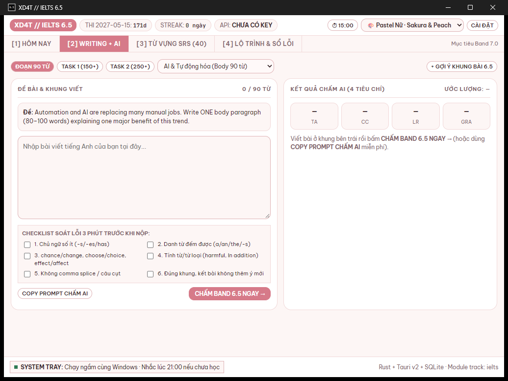
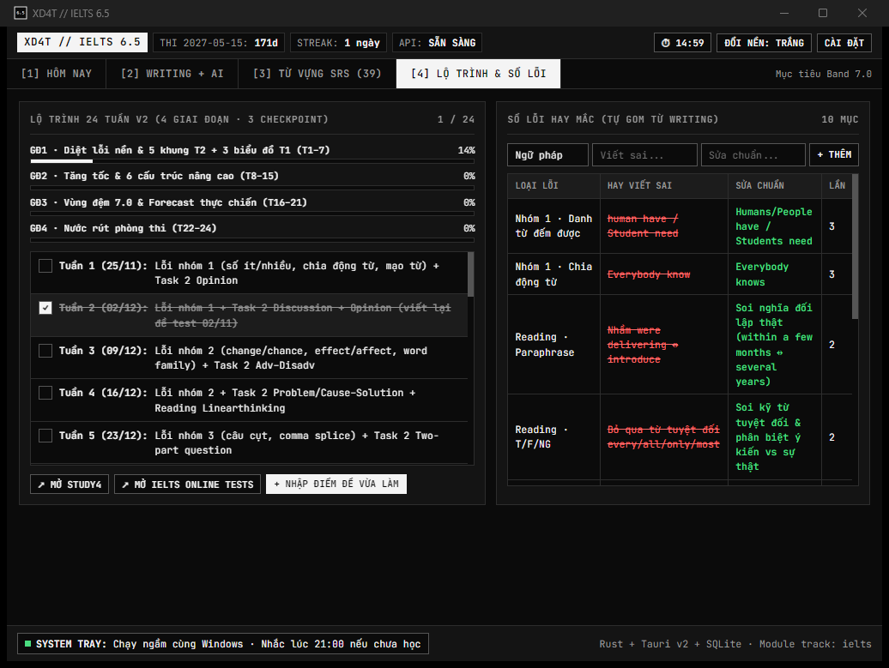
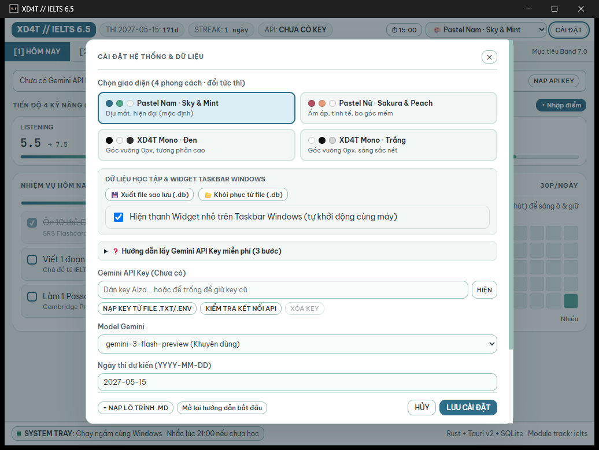

# Hướng Dẫn Sử Dụng XD4T IELTS 6.5 Từ A–Z (Dành Cho Người Mới)

[← Quay lại trang giới thiệu chính](../README.md)

Chào bạn! Nếu bạn mới bắt đầu tự học IELTS hoặc không rành công nghệ, hướng dẫn này sẽ chỉ bạn từng bước thật chậm, rõ ràng và đúng theo từng nút bấm trong app **XD4T IELTS (v1.6.0)**.

---

## Mục lục nhảy nhanh

- [Phần 1: Thiết lập nhanh trong 1 phút lần đầu mở app](#phần-1-thiết-lập-nhanh-trong-1-phút-lần-đầu-mở-app)
- [Phần 2: Cách học đúng 30 phút mỗi ngày trên tab `[1] HÔM NAY`](#phần-2-cách-học-đúng-30-phút-mỗi-ngày-trên-tab-1-hôm-nay)
- [Phần 3 (Trọng tâm): Cách luyện trên Study4 & nhập điểm vào app](#phần-3-trọng-tâm-cách-luyện-trên-study4--nhập-điểm-vào-app)
- [Phần 4: Luyện viết & chấm bài bằng AI ở tab `[2] WRITING + AI`](#phần-4-luyện-viết--chấm-bài-bằng-ai-ở-tab-2-writing--ai)
- [Phần 5: Học từ vựng nhớ lâu ở tab `[3] TỪ VỰNG SRS`](#phần-5-học-từ-vựng-nhớ-lâu-ở-tab-3-từ-vựng-srs)
- [Phần 6: Theo dõi lộ trình 24 tuần, nạp lộ trình riêng & ghi Sổ lỗi ở tab `[4] LỘ TRÌNH & SỔ LỖI`](#phần-6-theo-dõi-lộ-trình-24-tuần-nạp-lộ-trình-riêng--ghi-sổ-lỗi-ở-tab-4-lộ-trình--sổ-lỗi)
- [Phần 7: Các mục hay dùng trong `CÀI ĐẶT`](#phần-7-các-mục-hay-dùng-trong-cài-đặt)
- [Phần 8: Xử lý nhanh lỗi / thắc mắc người mới hay gặp](#phần-8-xử-lý-nhanh-lỗi--thắc-mắc-người-mới-hay-gặp)

---

## Phần 1: Thiết lập nhanh trong 1 phút lần đầu mở app

Ngay lần đầu mở app, màn hình **Chào mừng** sẽ hiện ra với **3 bước** rất nhanh (hoặc bạn có thể bấm **Bỏ qua** ở góc trên phải nếu muốn vào học ngay):

1. **Bước 1 — Chọn phong cách (`1. Chọn phong cách`):**
   - Chọn 1 trong 4 màu giao diện dịu mắt: **Pastel Nam** (xanh dịu), **Pastel Nữ** (hồng đào), **Mono Đen** (nền tối), hoặc **Mono Trắng** (nền sáng).
   - Bấm **Tiếp tục →**.
2. **Bước 2 — Chọn cấp độ & Lộ trình học (`2. Lộ trình học`):**
   - App tích hợp sẵn **2 chế độ lộ trình 24 tuần** (xoay vòng nhiệm vụ T2 → CN & gắn KPI định lượng từng tuần):
     - **🎯 Lộ trình Tiêu chuẩn · Aim 6.5 (Vùng đệm 7.0):** Nếu bạn đang ở nền **4.5–5.5**, hãy đi chắc từ chế độ này để diệt lỗi gốc, nắm 5 khung Writing và xây nền vững.
     - **🚀 Lộ trình Nâng cao · Aim 8.0:** Khi đã **vững nền 6.5+** (Listening/Reading ≥ 27–30/40 câu, nắm chắc câu phức), hãy bật chế độ này (hoặc đổi bất cứ lúc nào trong **Cài đặt**) để mở khóa 40 từ C1–C2 & Hedging cùng tiêu chí chấm Band 8.0.
   - Nếu muốn tạo lộ trình riêng theo ngày thi, bạn có thể bấm **📋 Copy câu lệnh gửi ChatGPT / Gemini** hoặc **📂 Mở trình nạp file .md** (xem chi tiết ở Phần 6).
3. **Bước 3 — Chấm Writing AI (`3. Chấm Writing AI`):**
   - Bạn có thể gắn **Google Gemini API Key miễn phí** ngay tại đây, hoặc bỏ qua để dùng cách **Copy Prompt** gửi sang ChatGPT/Gemini web miễn phí 100%.
4. **Màn Hoàn tất:** Bấm nút bắt đầu để vào màn hình chính của app.

---

## Phần 2: Cách học đúng 30 phút mỗi ngày trên tab `[1] HÔM NAY`

Mỗi ngày bạn chỉ cần mở tab **`[1] HÔM NAY`** và làm đúng 3 việc nhỏ là đủ giữ nhịp:

1. **Xem 4 thẻ điểm kỹ năng ở trên cùng:**
   - Gồm **Listening**, **Reading**, **Writing ★**, **Speaking** kèm điểm hiện tại và điểm mục tiêu (ví dụ `5.5 → 6.5`).
2. **Bấm đồng hồ tập trung 15 phút:**
   - Ở góc trên bên phải có nút **`⏱ 15:00`**. Bấm vào để bắt đầu đếm ngược 15 phút, bấm lần nữa để tạm dừng.
3. **Tick xong `NHIỆM VỤ HÔM NAY (30 PHÚT · BẤM ĐỂ TICK)`:**
   - Danh sách gồm 3 nhiệm vụ gọn nhẹ (mỗi nhiệm vụ khoảng 10 phút). Làm xong việc nào, bạn **bấm thẳng vào dòng đó** để đánh dấu `✓`.
4. **Giữ chuỗi ngày học trên `HEATMAP CHUỖI HỌC (10 TUẦN)`:**
   - Mỗi ô vuông nhỏ là 1 ngày.
   - **Quan trọng:** Bạn cần tick hoàn thành **ít nhất 1 nhiệm vụ (≥ 10 phút)** mỗi ngày để ô hôm nay sáng màu và không bị đứt chuỗi ngày học (streak).

---

## Phần 3 (Trọng tâm): Cách luyện trên Study4 & nhập điểm vào app

Nhiều bạn mới học thường bị ngợp khi làm đề full 60 phút. Cách tốt nhất là **luyện từng phần nhỏ trên Study4** rồi **quay lại app lưu điểm** để theo dõi tiến độ.

### 3.1. Study4 là gì?
**Study4** (`https://study4.com`) là trang web luyện đề **Cambridge IELTS** online miễn phí rất phổ biến tại Việt Nam, có sẵn đáp án, giải thích và tự chấm số câu đúng.

### 3.2. Các bước luyện Reading / Listening gọn nhẹ trên Study4
1. Mở trình duyệt web, vào **`https://study4.com`** và **đăng ký / đăng nhập tài khoản miễn phí** (có thể đăng nhập nhanh bằng Google).
2. Trên thanh menu, chọn mục **Đề thi online** → chọn 1 bộ đề **Cambridge IELTS** (ví dụ: *Cambridge IELTS 15*, *16*, *17*...).
3. Chọn chế độ **Luyện tập** (không cần chọn *Full Test* nếu bạn chỉ có 15–20 phút).
4. **Chỉ tick chọn 1 Passage (Reading)** hoặc **1 Section (Listening)**, đặt giới hạn thời gian **15–20 phút** rồi bấm **Bắt đầu**.
5. Làm xong, bấm **Nộp bài** để Study4 chấm tự động và xem số câu đúng của bạn (ví dụ: `9/13 câu` hoặc `23/40 câu`).

### 3.3. Bảng quy đổi nhanh số câu đúng sang Band tham khảo
Nếu bạn làm **Full Test (40 câu)** hoặc chỉ làm **1 Passage / 1 Section (13–14 câu)**, hãy đối chiếu bảng dưới đây để ước lượng Band điểm nhập vào app:

| Làm 1 Passage / Section (13–14 câu) | Làm Full Test (40 câu) | Band tham khảo |
|---|---|---|
| 4 – 5 câu đúng | 13 – 15 câu đúng | **4.5** |
| 6 – 7 câu đúng | 16 – 19 câu đúng | **5.0** |
| 8 câu đúng | 20 – 22 câu đúng | **5.5** |
| 9 – 10 câu đúng | 23 – 26 câu đúng | **6.0** |
| 11 câu đúng | 27 – 29 câu đúng | **6.5** |
| 12 câu đúng | 30 – 32 câu đúng | **7.0** |
| 13 – 14 câu đúng | 33+ câu đúng | **7.5+** |

### 3.4. Quay lại XD4T IELTS để nhập điểm
1. Mở app **XD4T IELTS** — bạn có thể bấm nút **`+ Nhập điểm`** (hoặc bấm thẳng vào 1 trong 4 thẻ Band **Listening / Reading / Speaking / Writing**) ngay trên tab **`[1] HÔM NAY`**, hoặc bấm sang tab **`[4] LỘ TRÌNH & SỔ LỖI`**.
2. Ở cuối khung lộ trình bên trái (tab 4), bạn có thể bấm **`↗ MỞ STUDY4`** (hoặc **`↗ MỞ IELTS ONLINE TESTS`**) để mở nhanh web luyện đề bất cứ lúc nào.
3. Khi đã có điểm, bấm nút **`+ NHẬP ĐIỂM ĐỀ VỪA LÀM`** (hoặc **`+ Nhập điểm`** ở tab 1).
4. Trong cửa sổ **`NHẬP ĐIỂM ĐỀ VỪA LÀM`** vừa hiện ra, điền 4 ô:
   - **Kỹ năng:** chọn `Listening`, `Reading`, `Writing`, hoặc `Speaking`.
   - **Nguồn đề (VD: Study4 Cam 15 Test 1):** gõ tên đề bạn vừa làm (mặc định đang điền sẵn `Study4 Cambridge`).
   - **Band điểm (0.0 – 9.0):** nhập mức Band quy đổi ở bảng trên (ví dụ `6.0`).
   - **Ghi chú:** ghi lại số câu đúng hoặc lỗi cần nhớ (ví dụ `Đúng 9/13 câu Passage 1`).
5. Bấm **`LƯU ĐIỂM`** để cập nhật lên 4 thẻ điểm ở trang chính.

> **Mẹo giữ chuỗi:** Sau khi lưu điểm xong, nhớ quay lại tab **`[1] HÔM NAY`** và **tick hoàn thành nhiệm vụ** để app ghi nhận bạn đã học hôm nay nhé!

---

## Phần 4: Luyện viết & chấm bài bằng AI ở tab `[2] WRITING + AI`

1. Bấm sang tab **`[2] WRITING + AI`**.
2. Ở hàng trên cùng, chọn chế độ viết phù hợp trình độ:
   - **`ĐOẠN 90 TỪ`**: dành cho người mới tập viết câu chuẩn.
   - **`TASK 1 (150+)`**: luyện viết biểu đồ.
   - **`TASK 2 (250+)`**: luyện viết bài luận.
3. Chọn đề bài ở ô danh sách bên cạnh. Nếu bí ý, bấm **`+ GỢI Ý KHUNG BÀI 6.5`** ở góc phải để xem dàn ý mẫu.
4. Viết bài vào khung **`Nhập bài viết tiếng Anh của bạn tại đây...`** (app tự đếm số từ ở góc trên phải khung viết).
5. Trước khi nộp, tick nhanh mục **`CHECKLIST SOÁT LỖI 3 PHÚT TRƯỚC KHI NỘP`** để tự kiểm tra các lỗi cơ bản.
6. Chọn 1 trong 2 cách chấm bài:
   - **Cách 1 (Tự động trong app):** Bấm **`CHẤM BAND 6.5 NGAY →`** (cần có Gemini API Key miễn phí trong `CÀI ĐẶT`).
   - **Cách 2 (Miễn phí 100%, không cần API Key):** Bấm **`COPY PROMPT CHẤM AI`**, sau đó mở ChatGPT hoặc Gemini trên web và dán (`Ctrl + V`) để AI chấm.
7. Sau khi AI chấm xong ở khung bên phải, bấm **`+ LƯU LỖI VÀO SỔ`** để lưu các lỗi sai vào Sổ lỗi tự động.

---

## Phần 5: Học từ vựng nhớ lâu ở tab `[3] TỪ VỰNG SRS`

Tab **`[3] TỪ VỰNG SRS`** giúp bạn học từ vựng **hoàn toàn offline** (không cần mạng) theo thuật toán nhắc ôn tự động:

1. Bấm vào giữa thẻ từ vựng để lật xem **nghĩa tiếng Việt** và **câu ví dụ**.
2. Sau khi xem, bấm 1 trong 4 nút bên dưới tùy mức độ nhớ của bạn:
   - **`[1] QUÊN · 10p`**: chưa nhớ → app sẽ hỏi lại sau 10 phút.
   - **`[2] KHÓ · 1 ngày`**: nhớ mang máng → hẹn ôn lại vào ngày mai.
   - **`[3] NHỚ · 3 ngày`**: nhớ ổn → hẹn ôn lại sau 3 ngày.
   - **`[4] DỄ · 7 ngày`**: nhớ rất chắc → hẹn ôn lại sau 7 ngày.

### 5.1. Chữa 🔥 Từ cứng đầu (Leech), Quiz Sửa Lỗi, Micro-Check 2p & Nghe chép câu (v1.6.0)
- **Flashcard 3 mặt thẻ & Chữa từ cứng đầu:** Chọn **`Mặt từ`**, **`Câu đục lỗ`**, hoặc **`🎧 Nghe trước`** (ẩn chữ tới khi lật). Khi một từ bị quên ≥ 3 lần, thẻ hiện badge **`🔥 Từ cứng đầu`** cùng nút **`✍️ Chữa từ này`** để bạn tự đặt 1 câu mới với từ đó và lưu thành thẻ Cloze mới. Dùng nút **`+ Thêm từ`** để nạp từ mới từ Study4 (**Sentence Mining**), hoặc đổi giọng **`en-GB` / `en-US`** trong **`CÀI ĐẶT`**.
- **Quiz & Sửa lỗi:** Gồm 3 pill: **`📝 Quiz Từ vựng`**, **`🔧 Quiz Gõ Sửa Lỗi`** (gõ lại cụm sửa chuẩn từ Sổ lỗi, so khớp linh hoạt), và **`⚡ Micro-Check 5 câu (2p)`** (trộn 2 từ dễ quên + 2 câu Sổ lỗi + 1 cặp Paraphrase).
- **🎧 Nghe chép câu (Dictation 100% offline):** Chọn tốc độ **`0.85x | 1.0x | 1.15x`**, nghe bằng phím **`Ctrl + Space`**, gõ lại nguyên câu rồi bấm **`Kiểm tra (Enter)`** để xem từng từ đúng/sai (xanh/đỏ) và bấm **`+ Đẩy vào Sổ lỗi Listening`**.

### 5.2. Phòng Luyện Nói (Speaking Studio — 48 Cue Card 24 tuần)
- Mở từ **`Quick Actions → 🎙️ Phòng Luyện Nói`** hoặc nhiệm vụ Core trên Tab 1.
- Hỗ trợ 2 chế độ: **`🎯 Thi thật (Part 2 + Part 3)`** và **`⚡ Phản xạ 4-3-2`**.
- Nếu có Gemini API Key, bấm **`✨ Chấm AI (Gemini Audio)`** để nhận Transcript, 4 Band `FC/LR/GRA/P*`, WPM, số từ đệm và tự đẩy 3 lỗi sang Sổ lỗi (`Speaking`). Nếu chưa có key, dùng **`⬇ Tải file ghi âm`**, **`📋 Copy Prompt + Rubric`**, hoặc **`✓ Tự chấm 5 mục`**.

---

## Phần 6: Theo dõi lộ trình 24 tuần, nạp lộ trình riêng, Sổ lỗi & Bảng Paraphrase ở tab `[4] LỘ TRÌNH & SỔ LỖI`

### 6.1. Theo dõi & nạp lộ trình cá nhân (`.md`)
- Khung bên trái hiển thị tiến độ từng giai đoạn và danh sách từng tuần. Học xong tuần nào, bạn bấm vào tuần đó để tick `✓`.
- Nếu muốn đổi sang lộ trình riêng theo ngày thi của bạn:
  1. Bấm **`+ NẠP LỘ TRÌNH .MD`**.
  2. Trong cửa sổ **`NẠP LỘ TRÌNH CÁ NHÂN (.MD)`**, bấm **`COPY PROMPT TẠO LỘ TRÌNH CHO AI`** rồi dán vào ChatGPT / Claude / Gemini web và trả lời 5 câu hỏi ngắn.
  3. Copy kết quả AI tạo ra (hoặc lưu thành file `.md`), dán vào ô trống hoặc bấm **`CHỌN FILE .MD TỪ MÁY`**.
  4. Bấm **`PHÂN TÍCH & XEM TRƯỚC`** để kiểm tra số tuần/nhiệm vụ, rồi bấm **`ÁP DỤNG LỘ TRÌNH NGAY`**.

### 6.2. Ghi Sổ lỗi hay mắc
- Khung bên phải là **`SỔ LỖI HAY MẮC (TỰ GOM TỪ WRITING)`**.
- Ngoài các lỗi được lưu tự động từ tab Writing, bạn có thể tự thêm lỗi Reading/Listening bằng cách điền 3 ô **`Loại lỗi`**, **`Viết sai...`**, **`Sửa chuẩn...`** rồi bấm **`+ THÊM`**.

---

## Phần 7: Các mục hay dùng trong `CÀI ĐẶT`

Bấm nút **`CÀI ĐẶT`** ở góc trên bên phải màn hình để mở:

- **Đổi màu giao diện:** Chọn nhanh giữa 4 màu (**Pastel Nam**, **Pastel Nữ**, **Mono Đen**, **Mono Trắng**).
- **Lấy Gemini API Key miễn phí (3 bước):**
  1. Bấm **`↗ LẤY KEY MIỄN PHÍ TẠI GOOGLE AI STUDIO`** và đăng nhập Google.
  2. Chọn **Create API key** → copy chuỗi bắt đầu bằng `AIza...`.
  3. Dán vào ô **Gemini API Key** → bấm **`KIỂM TRA KẾT NỐI API`** → bấm **`LƯU CÀI ĐẶT`**.
- **Chỉnh ngày thi & giờ nhắc học:** Sửa ô **`Ngày thi dự kiến (YYYY-MM-DD)`** và **`Giờ nhắc học mỗi ngày (HH:MM)`**, sau đó bấm **`LƯU CÀI ĐẶT`**.
- **Thanh nhắc nhỏ trên Taskbar Windows:** Tick hoặc bỏ tick ô **`Hiện thanh Widget nhỏ trên Taskbar Windows (tự khởi động cùng máy)`** để bật/tắt thanh nhắc nhỏ dưới góc màn hình.
- **Sao lưu & Khôi phục dữ liệu:**
  - Trước khi đổi máy hoặc cài lại Windows, bấm **`💾 Xuất file sao lưu (.db)`** để lưu toàn bộ bài học thành 1 file.
  - Sang máy mới, mở `CÀI ĐẶT` → bấm **`📂 Khôi phục từ file (.db)`** và chọn lại file đó.

| Cài đặt & Sao lưu dữ liệu | Thanh nhắc nhỏ dưới Taskbar |
|---|---|
|  |  |

---

## Phần 8: Xử lý nhanh lỗi / thắc mắc người mới hay gặp

- **Windows hiện bảng xanh "Windows protected your PC" khi cài đặt:**
  Đây là cảnh báo mặc định của Windows với phần mềm miễn phí mới phát hành. Bạn chỉ cần bấm **`More info`** → **`Run anyway`** là cài bình thường.
- **Muốn xem lại màn hình hướng dẫn 3 bước ban đầu:**
  Vào **`CÀI ĐẶT`** → bấm nút **`Mở lại hướng dẫn bắt đầu`** ở góc dưới bên trái.
- **Bấm `KIỂM TRA KẾT NỐI API` báo lỗi:**
  Kiểm tra lại xem bạn đã copy đủ chuỗi `AIza...` chưa (không thừa dấu cách ở đầu/cuối) và máy tính có đang kết nối Internet không. Nếu vẫn lỗi, bạn vẫn có thể dùng nút **`COPY PROMPT CHẤM AI`** ở tab Writing hoàn toàn miễn phí.
- **Đổi máy tính hoặc gỡ app cài lại có mất dữ liệu không?**
  Nếu gỡ app trên cùng một máy theo cách thông thường của Windows, dữ liệu vẫn còn nguyên. Nếu đổi sang máy mới, bạn chỉ cần dùng nút **`💾 Xuất file sao lưu (.db)`** và **`📂 Khôi phục từ file (.db)`** trong `CÀI ĐẶT`.
