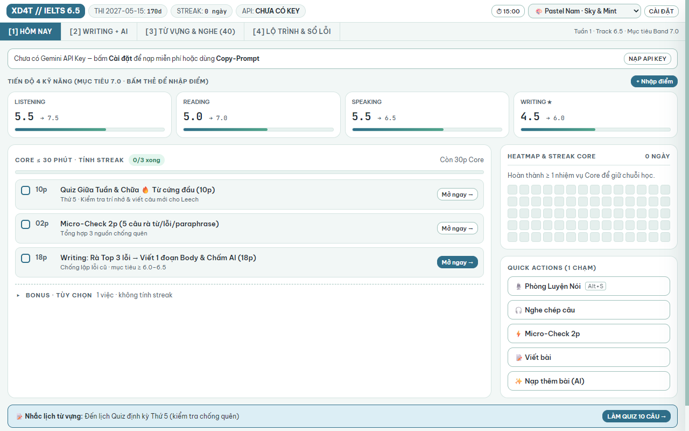
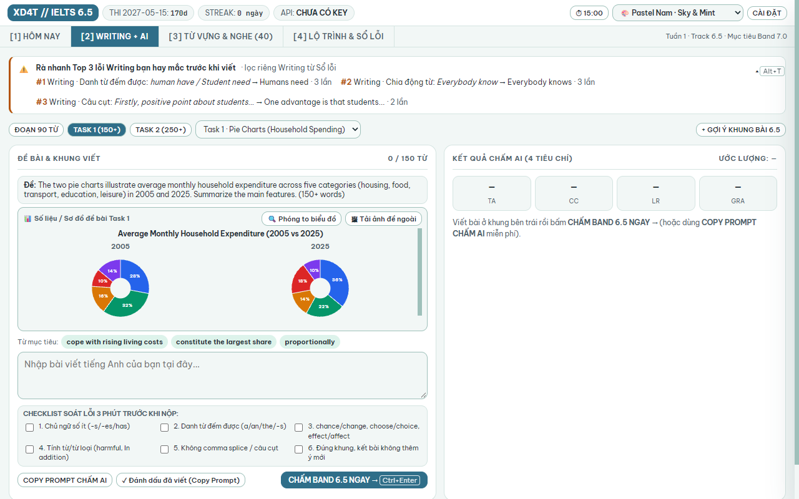
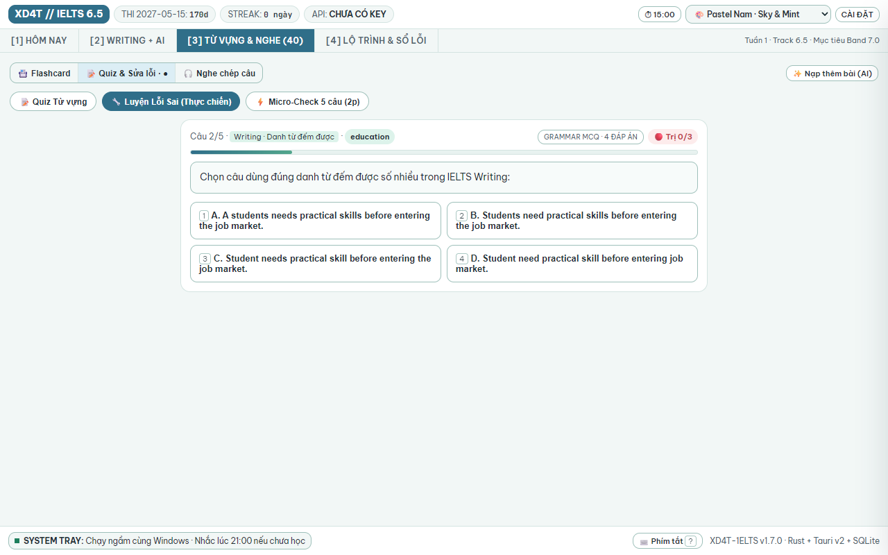
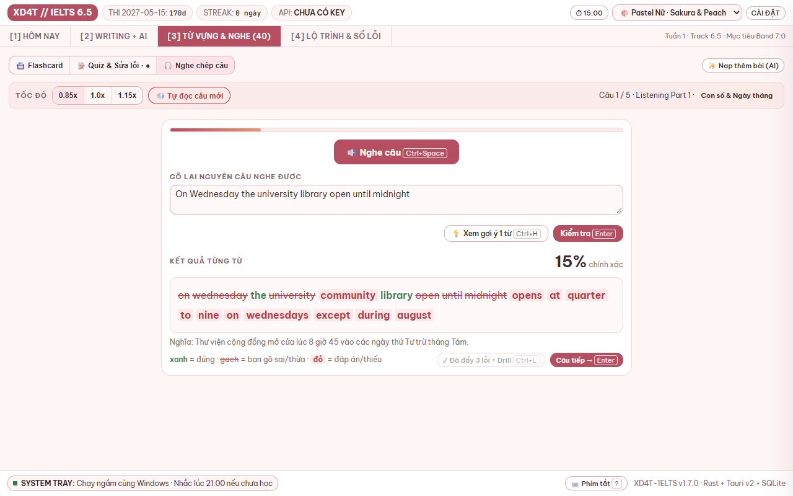
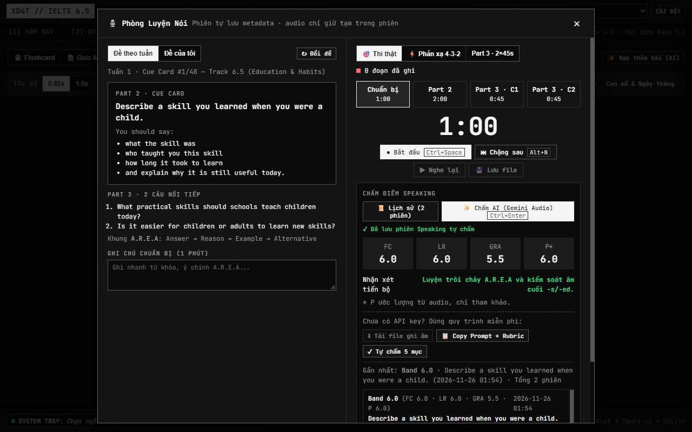
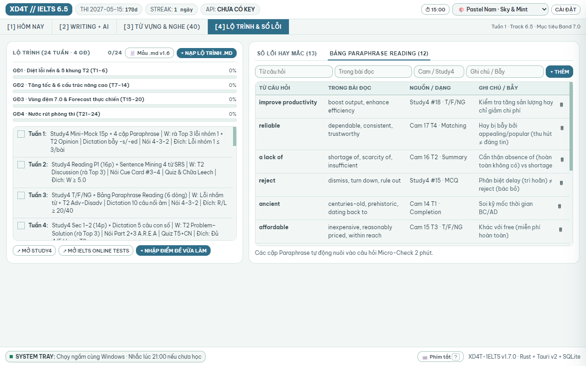

# Hướng Dẫn Sử Dụng XD4T IELTS 6.5 Từ A–Z (Dành Cho Người Mới)

[← Quay lại trang giới thiệu chính](../README.md)

Chào bạn! Nếu bạn mới bắt đầu tự học IELTS hoặc không rành công nghệ, hướng dẫn này sẽ chỉ bạn từng bước thật chậm, rõ ràng và đúng theo từng nút bấm trong app **XD4T IELTS (v1.7.0)**.

---

## Mục lục nhảy nhanh

- [Phần 1: Thiết lập nhanh trong 1 phút lần đầu mở app](#phần-1-thiết-lập-nhanh-trong-1-phút-lần-đầu-mở-app)
- [Phần 2: Cách học đúng 30 phút Core mỗi ngày trên tab `[1] HÔM NAY`](#phần-2-cách-học-đúng-30-phút-core-mỗi-ngày-trên-tab-1-hôm-nay)
- [Phần 3 (Trọng tâm): Cách luyện Study4 Mini-Mock & quy đổi điểm](#phần-3-trọng-tâm-cách-luyện-study4-mini-mock--quy-đổi-điểm)
- [Phần 4: Luyện viết, Biểu đồ SVG Task 1 & chấm AI ở tab `[2] WRITING + AI`](#phần-4-luyện-viết-biểu-đồ-svg-task-1--chấm-ai-ở-tab-2-writing--ai)
- [Phần 5: Từ vựng SRS, Luyện Lỗi Thực Chiến, Dictation & Speaking Studio ở tab `[3]`](#phần-5-từ-vựng-srs-luyện-lỗi-thực-chiến-dictation--speaking-studio-ở-tab-3)
- [Phần 6: Lộ trình 24 tuần, Sổ lỗi Mastery, Bảng Paraphrase & Nạp Gói AI ở tab `[4]`](#phần-6-lộ-trình-24-tuần-sổ-lỗi-mastery-bảng-paraphrase--nạp-gói-ai-ở-tab-4)
- [Phần 7: Bảng tra cứu Phím Tắt Liên Tục (`0 chạm chuột`)](#phần-7-bảng-tra-cứu-phím-tắt-liên-tục-0-chạm-chuột)
- [Phần 8: Cài đặt, Tự nạp gói Chủ Nhật & Sao lưu `.db`](#phần-8-cài-đặt-tự-nạp-gói-chủ-nhật--sao-lưu-db)
- [Phần 9: Xử lý nhanh các thắc mắc thường gặp](#phần-9-xử-lý-nhanh-các-thắc-mắc-thường-gặp)

---

## Phần 1: Thiết lập nhanh trong 1 phút lần đầu mở app

Ngay lần đầu mở app, màn hình **Chào mừng** sẽ hiện ra với **3 bước** (hoặc bấm **Bỏ qua** ở góc trên phải để vào học ngay):

1. **Bước 1 — Chọn phong cách:** Chọn 1 trong 4 giao diện dịu mắt: **Pastel Nam** (Sky & Mint), **Pastel Nữ** (Sakura & Peach), **Mono Đen**, hoặc **Mono Trắng** → bấm **Tiếp tục →**.
2. **Bước 2 — Chọn cấp độ & Lộ trình học (`Aim 6.5` ↔ `Aim 8.0`):**
   - **🎯 Lộ trình Tiêu chuẩn · Aim 6.5 (Vùng đệm 7.0):** Phù hợp nền 4.5–5.5, diệt lỗi gốc, nắm 5 khung Writing và săn 30–34/40 câu.
   - **🚀 Lộ trình Nâng cao · Aim 8.0:** Khuyến khích khi bạn đã vững nền 6.5+ (L/R ≥ 27–30/40). Bật chế độ này sẽ mở khóa từ vựng C1–C2 & Hedging, 24 cặp Paraphrase nâng cao, 30 bài sửa lỗi Band 8.0 và tiêu chí chấm nghiêm hơn.
   - Bạn có thể chuyển đổi qua lại giữa `Aim 6.5` và `Aim 8.0` bất kỳ lúc nào trong **Cài đặt** (toàn bộ dữ liệu cũ vẫn được giữ an toàn).
3. **Bước 3 — Chấm AI (tùy chọn):** Dán **Google Gemini API Key miễn phí** (hoặc nạp nhanh từ file `.txt`/`.env`) để bật AI chấm Writing, chấm Speaking Audio và nạp gói bài mới. Nếu chưa có key, bấm **Bỏ qua** — mọi chức năng học + **Copy Prompt** vẫn dùng miễn phí 100%.

---

## Phần 2: Cách học đúng 30 phút Core mỗi ngày trên tab `[1] HÔM NAY`

Tab **`[1] HÔM NAY`** chia rõ việc **BẮT BUỘC (`CORE ≤ 30 phút · Tính Streak`)** và việc **TÙY CHỌN (`BONUS`)**:

1. **Theo dõi 4 thẻ điểm kỹ năng ở trên cùng:** Bấm thẳng vào thẻ **Listening / Reading / Speaking / Writing ★** (hoặc nút **`+ Nhập điểm`**) để lưu điểm mới từ Study4.
2. **Làm đủ 3 nhiệm vụ `CORE` (mỗi ngày xoay vòng thông minh T2 → CN):**
   - **SRS Từ vựng (8–10p):** Bấm **`Mở ngay →`** để nhảy thẳng tới Flashcard. Khi bạn ôn xong ít nhất 1 thẻ, nhiệm vụ SRS tự động tick `✓`.
   - **Micro-Check 2p / Quiz Luyện lỗi (2–10p):** Bấm **`Mở ngay →`** để mở đúng **Quiz Từ vựng** hoặc **Micro-Check 5 câu**. Hoàn thành xong app tự tick nhiệm vụ và cộng phút vào Heatmap.
   - **Kỹ năng trọng tâm trong ngày (16–20p):** Đan xen giữa Writing, Phòng Luyện Nói, Nghe chép Dictation và 4 buổi Mini-Mock trên Study4.
3. **Nút `QUICK ACTIONS (1 CHẠM)` bên phải:** Mở nhanh **`🎙️ Phòng Luyện Nói (Alt+S)`**, **`🎧 Nghe chép câu`**, **`⚡ Micro-Check 2p`**, **`📝 Viết bài`**, **`✨ Nạp thêm bài (AI)`**.
4. **Giữ chuỗi Streak trên Heatmap:** Chỉ cần xong tối thiểu 1 nhiệm vụ **Core** mỗi ngày là ô Heatmap hôm nay sáng màu và giữ chuỗi ngày học. (Mục **BONUS** giúp học thêm khi rảnh, không ép vào streak.)

---

## Phần 3 (Trọng tâm): Cách luyện Study4 Mini-Mock & quy đổi điểm

Thay vì ép làm cả bài thi 60 phút dễ nản, bạn chỉ cần làm **1 Passage Reading hoặc 1–2 Section Listening (14–16 phút)** trên **Study4**:

1. Truy cập **`https://study4.com`** (bấm nhanh nút **`↗ MỞ STUDY4`** ở tab `[4]`).
2. Vào **Đề thi online** → chọn 1 bộ **Cambridge IELTS** → chọn chế độ **Luyện tập**.
3. Chỉ tick **1 Passage** (hoặc **1 Section Listening**), đặt timer **15 phút** rồi bấm **Bắt đầu**.
4. Làm xong bấm **Nộp bài**, đối chiếu bảng dưới đây rồi quay lại tab `[1]` bấm **`+ Nhập điểm`**:

| Làm 1 Passage / Section (13–14 câu) | Làm Full Test (40 câu) | Band tham khảo |
|---|---|---|
| 4 – 5 câu đúng | 13 – 15 câu đúng | **4.5** |
| 6 – 7 câu đúng | 16 – 19 câu đúng | **5.0** |
| 8 câu đúng | 20 – 22 câu đúng | **5.5** |
| 9 – 10 câu đúng | 23 – 26 câu đúng | **6.0** |
| 11 câu đúng | 27 – 29 câu đúng | **6.5** |
| 12 câu đúng | 30 – 32 câu đúng | **7.0** |
| 13 – 14 câu đúng | 33+ câu đúng | **7.5 – 8.0** |

> **Mẹo quan trọng:** Khi gặp câu sai hoặc từ lạ trên Study4, thêm thẳng cặp đồng nghĩa vào **Bảng Paraphrase Reading** hoặc thêm từ vào **Sentence Mining** ở tab `[3]` để app tự đưa vào bài ôn mỗi ngày!

---

## Phần 4: Luyện viết, Biểu đồ SVG Task 1 & chấm AI ở tab `[2] WRITING + AI`

1. **Rà nhanh `⚠️ Top 3 lỗi Writing` ở trên cùng (`Alt+T` để thu gọn/mở):** Thanh này chỉ lọc riêng lỗi thuộc **Writing** từ Sổ lỗi để bạn tránh lặp lại trước khi gõ.
2. **Chọn chế độ & Đề bài:**
   - **`ĐOẠN 90 TỪ`**: tập viết 1 đoạn Body chặt chẽ (Topic → Explain → Example → Result).
   - **`TASK 1 (150+)`**: 100% đề Task 1 trong app đều đi kèm **Biểu đồ / Sơ đồ SVG chuẩn Cambridge** (Line, Bar, 2 Pie Charts, Table, Process, Map Before/After, Mixed). Bấm **`🔍 Phóng to biểu đồ`** để xem cỡ lớn, hoặc bấm **`🖼 Tải ảnh đề ngoài`** nếu bạn muốn nạp ảnh chụp 1 đề Task 1 bên ngoài để viết kèm.
   - **`TASK 2 (250+)`**: luyện đủ 5 dạng Opinion, Discussion, Adv–Disadv, Problem–Solution, Two-Part.
3. **Tận dụng `Từ mục tiêu` & `+ GỢI Ý KHUNG BÀI`:** Đưa các collocations gợi ý ngay dưới đề vào bài viết; bấm **`+ GỢI Ý KHUNG BÀI`** khi cần xem dàn ý nhanh (khung gợi ý cuộn gọn bên trong để không che mất nút nộp bài).
4. **3 cách nộp & hoàn thành bài viết:**
   - **Có API Key:** Bấm **`CHẤM BAND NGAY →` (`Ctrl+Enter`)**. Với Task 1, app tự gửi kèm số liệu biểu đồ cho AI chấm *Task Achievement* chính xác, trả về 4 điểm **TA / CC / LR / GRA**, bản viết lại chuẩn Band 6.5 hoặc 8.0, sửa từng câu, và **cảnh báo nếu bạn lặp lại lỗi trong Top 3** (nếu tái phạm lỗi đã trị dứt điểm ở Sổ lỗi, app tự mở lại bài drill cho lỗi đó!).
   - **Không có API Key:** Bấm **`COPY PROMPT CHẤM AI`** (đã kèm sẵn số liệu biểu đồ Task 1 + điểm yếu cần soi) rồi dán vào ChatGPT/Gemini web miễn phí, sau đó bấm **`✓ Đánh dấu đã viết (Copy Prompt)`** để app auto-tick nhiệm vụ Writing hôm nay và cộng phút học!

---

## Phần 5: Từ vựng SRS, Luyện Lỗi Thực Chiến, Dictation & Speaking Studio ở tab `[3]`

### 5.1. Flashcard SRS & Chữa `🔥 Từ cứng đầu`
- Chọn 1 trong 3 mặt hiển thị: **`Mặt từ`**, **`Câu đục lỗ`** (hỗ trợ đục lỗ cả động từ chia thì `-s/-ed/-ing` không làm lộ đáp án), hoặc **`🎧 Nghe trước`** (`en-GB` / `en-US` chỉnh trong Cài đặt).
- Chấm 4 mức **`[1] Quên`** · **`[2] Khó`** · **`[3] Nhớ`** · **`[4] Dễ`**. Ôn xong ≥ 1 thẻ tự động tick nhiệm vụ Core SRS hôm nay.
- Khi 1 từ bị quên ≥ 3 lần sẽ hiện **`🔥 Từ cứng đầu`** + nút **`✍️ Chữa từ này`** (`C`): nhập 1 câu ví dụ mới có chứa từ (hoặc gốc từ) đó để biến thành thẻ Cloze mới dễ nhớ hơn.
- Nút **`🙈 Ẩn`** có thông báo **`Hoàn tác (Undo)` trong 5 giây**; nút **`🗑 Xóa`** tách riêng và yêu cầu bấm xác nhận 2 nhịp để tránh bấm nhầm.

### 5.2. Quiz Từ vựng, `🔧 Luyện Lỗi Sai (Thực chiến)` & `⚡ Micro-Check 5 câu (2p)`

Bấm vào pill **`Quiz & Sửa lỗi`** để chọn 1 trong 3 chế độ:
- **`📝 Quiz Từ vựng`:** Trộn 3 kiểu hỏi (chọn nghĩa, đục lỗ trong câu, gõ từ từ nghĩa + chữ cái đầu).
- **`🔧 Luyện Lỗi Sai (Thực chiến)`:** Thay cho việc chép lại cụm sai, bạn làm bài **Trắc nghiệm 4 đáp án (`GRAMMAR_MCQ`)**, **Tình huống Reading bẫy (`MINI_CASE`)**, hoặc **Gõ điền từ (`TYPING`)** hoàn toàn bằng tiếng Anh thực chiến. Hoàn thành phiên sẽ tự tick nhiệm vụ Core Quiz và cộng phút học!
- **`⚡ Micro-Check 5 câu (2p)`:** Đồng hồ đếm ngược `2:00` ổn định (tự dừng nếu bạn chuyển tab/thoát). Nếu chạm `0:00`, hiện banner **`⏱ Hết 2 phút`** cho phép bấm xem kết quả ngay hoặc làm nốt câu đang dở.

### 5.3. `🎧 Nghe chép câu (Dictation)` — 48 câu bẫy thực chiến

- Chọn tốc độ **`0.85x | 1.0x | 1.15x`**, nghe bằng **`Ctrl+Space`**, gõ lại nguyên câu rồi nhấn **`Enter`** để xem **Word-by-word Diff** (xanh = đúng, gạch = sai/thừa, đỏ = đáp án chuẩn).
- Bấm **`+ Đẩy vào Sổ lỗi Listening` (`Ctrl+L`)**: app tự tách tối đa **3 cặp từ sai cốt lõi** (`open → opens`, `wednesday → wednesdays`) ghi gọn vào Sổ lỗi (`Listening · Chính tả`) đồng thời **tự sinh bài drill đục lỗ `TYPING`** từ chính câu vừa nghe!

### 5.4. `🎙️ Phòng Luyện Nói (Speaking Studio)` (`Alt+S`)

- Chọn **48 Cue Card theo tuần** (24 tuần × 2 track) hoặc tab **`Đề của tôi`** (tự kiểm tra trống trước khi chạy).
- Chọn chế độ **`🎯 Thi thật (Part 2 + Part 3)`**, **`⚡ Phản xạ 4-3-2`**, hoặc **`Part 3 · 2×45s`**.
- Ghi âm trực tiếp nhiều chặng; khi bấm Dừng, app mở khóa ngay nút chọn nghe lại / lưu từng chặng (`Chặng 1`, `Chặng 2`, ...).
- Bấm **`✨ Chấm AI (Gemini Audio)` (`Ctrl+Enter`)** để lấy Transcript, 4 Band `FC / LR / GRA / P*`, tốc độ nói (WPM), số từ đệm và tự động đẩy top 3 lỗi sang Sổ lỗi (`Speaking`). Nếu không dùng key, dùng **`⬇ Tải file ghi âm`**, **`📋 Copy Prompt + Rubric`**, hoặc **`✓ Tự chấm 5 mục`**.
- Bấm **`📜 Lịch sử (N phiên)`** để xem toàn bộ quá trình tiến bộ qua các buổi trước.

---

## Phần 6: Lộ trình 24 tuần, Sổ lỗi Mastery, Bảng Paraphrase & Nạp Gói AI ở tab `[4]`

1. **Lộ trình 24 tuần · 4 Giai đoạn (bên trái):** Tick hoàn thành từng tuần, mở nhanh Study4 / IELTS Online Tests, bấm **`+ NHẬP ĐIỂM ĐỀ VỪA LÀM`**, hoặc bấm **`+ NẠP LỘ TRÌNH .MD`** để nạp lộ trình cá nhân (hỗ trợ giữ lại các tuần đã tick ✓ cũ).
2. **`SỔ LỖI HAY MẮC (Mastery Loop)` (bên phải):**
   - Mỗi lỗi hiển thị trạng thái trị lỗi: **`🔴 Đang trị · 0/3`** → **`🟡 Đang trị · 1/3`** → **`🟡 Đang trị · 2/3`** → **`✅ Đã trị dứt điểm`** (khi trả lời đúng **3 bài drill khác ngữ cảnh liên tiếp**).
   - Bấm **`✨ Sinh AI`** trên bất kỳ lỗi nào (khi có API key) để Gemini tạo riêng thêm 3 bài tập cho lỗi đó và lưu vĩnh viễn vào SQLite.
   - Nếu bạn lặp lại lỗi đó trong lúc chấm Writing/Speaking AI, app kích hoạt **Relapse Trigger** đưa lỗi về trạng thái đang trị để ôn lại.
3. **`BẢNG PARAPHRASE READING`:** Xem các cặp đồng nghĩa theo cấp độ hiện tại (`6.5` hoặc `8.0`) và tự thêm cặp mới từ Study4 để app tự động trộn vào **Micro-Check 2p**.
4. **`✨ Nạp thêm bài (AI)`:** Chọn 1 trong 12 chủ đề IELTS (Environment, Technology & AI, Education, Health, Economy, Urbanization, Media, Crime & Law, Work, Culture, Transport, Globalization) để Gemini sinh **25 bài học mới liên kết nhau** (+10 từ vựng · +5 Dictation · +2 đề Writing có kèm Chart JSON cho Task 1 · +5 Paraphrase · +3 Error Drills) gắn nhãn `✨ Mới nạp`.

---

## Phần 7: Bảng tra cứu Phím Tắt Liên Tục (`0 chạm chuột`)

Nhấn phím **`?`** bất cứ lúc nào trong app để bật bảng phím tắt nổi:

| Khu vực | Phím tắt | Tác dụng |
|---|---|---|
| **Toàn ứng dụng** | `Alt + 1` / `2` / `3` / `4` | Chuyển nhanh giữa 4 tab chính |
| **Toàn ứng dụng** | `Alt + S` | Mở / Đóng Phòng Luyện Nói (Speaking Studio) |
| **Toàn ứng dụng** | `?` | Bật / Tắt bảng phím tắt |
| **Toàn ứng dụng** | `Esc` | Đóng modal / phòng nói / bỏ focus ô nhập liệu |
| **Flashcard SRS** | `Space` hoặc `Enter` | Lật / Úp thẻ từ vựng |
| **Flashcard SRS** | `1` · `2` · `3` · `4` | Chấm `[1] Quên` · `[2] Khó` · `[3] Nhớ` · `[4] Dễ` |
| **Flashcard SRS** | `R` / `E` / `C` | Đọc từ / Đọc câu ví dụ / Mở khung Chữa từ (`Lưu: Ctrl+Enter`) |
| **Quiz / Luyện Lỗi / Micro-Check** | `1`–`4` hoặc `A`–`D` | Chọn nhanh đáp án trắc nghiệm 4 lựa chọn |
| **Quiz / Luyện Lỗi / Micro-Check** | `Enter → Enter` | Nhịp đôi: Chấm đáp án → Qua câu tiếp theo |
| **Quiz / Luyện Lỗi / Micro-Check** | `F` / `Ctrl + H` | Bỏ qua / Xem gợi ý đáp án |
| **Quiz / Luyện Lỗi / Micro-Check** | `Ctrl + Y` / `Ctrl + I` | Tự xác nhận đúng / Nhờ AI chấm câu sửa |
| **Dictation (Nghe chép)** | `Ctrl + Space` | Phát lại câu hiện tại |
| **Dictation (Nghe chép)** | `Ctrl + 1` / `2` / `3` | Đổi nhanh tốc độ `0.85x` / `1.0x` / `1.15x` |
| **Dictation (Nghe chép)** | `Ctrl + H` / `Ctrl + L` / `Enter` | Xem gợi ý 1 từ / Đẩy 3 lỗi vào Sổ lỗi / Kiểm tra & Câu tiếp |
| **Writing + AI** | `Alt + T` / `Ctrl + Enter` | Thu gọn Top 3 lỗi Writing / Gửi Chấm Band AI |
| **Speaking Studio** | `Ctrl + Space` / `Alt + N` / `Ctrl + Enter` | Bắt đầu–Dừng / Sang chặng sau / Chấm AI Audio |

---

## Phần 8: Cài đặt, Tự nạp gói Chủ Nhật & Sao lưu `.db`

Mở nút **`CÀI ĐẶT`** ở góc trên phải:
- **Đổi theme & Cấp độ:** Chuyển mượt giữa 4 màu giao diện và **`Aim 6.5` ↔ `Aim 8.0`**.
- **Tự động nạp gói chủ đề AI hàng tuần:** Khi đã có Gemini API Key và bật tùy chọn này, app sẽ **tự động nạp ngầm 1 gói 25 bài theo chủ đề tuần mới** vào **Chủ Nhật hàng tuần** (hoặc khi bạn đã học đủ chặng tiến độ & qua thời gian chờ) và hiện thông báo nhỏ trên Tab 1. Có khóa chống nạp trùng trong ngày và hiển thị ngày/chủ đề nạp gần nhất ngay trong Cài đặt.
- **Giọng đọc TTS & Ngày thi:** Chọn giọng **`en-GB` (Anh-Anh)** hoặc **`en-US` (Anh-Mỹ)**, chỉnh ngày thi dự kiến & giờ nhắc học Windows.
- **Sao lưu & Khôi phục dữ liệu:** Bấm **`💾 Xuất file sao lưu (.db)`** định kỳ và **`📂 Khôi phục từ file (.db)`** khi chuyển máy.

---

## Phần 9: Xử lý nhanh các thắc mắc thường gặp

- **Windows hiện bảng xanh "Windows protected your PC" khi mở file cài đặt:**
  Chọn **`More info`** → **`Run anyway`** (app mã nguồn mở phát hành miễn phí nên chưa mua chữ ký số thương mại).
- **Nút `Chấm AI Writing / Speaking` báo chưa có key:**
  Bạn có thể gắn Gemini API Key miễn phí từ Google AI Studio trong **Cài đặt**, hoặc dùng ngay **`COPY PROMPT CHẤM AI`** + **`✓ Đánh dấu đã viết (Copy Prompt)`** / **`✓ Tự chấm 5 mục`** mà không cần tạo key.
- **Đổi máy tính hoặc gỡ app cài lại có mất bài đang học không?**
  Không mất nếu ở lại cùng máy (DB nằm trong `%APPDATA%\xd4t-ielts65\ielts65.db`). Khi đổi sang máy khác, nhớ bấm **`💾 Xuất file sao lưu (.db)`** mang theo là khôi phục đủ 100%.
